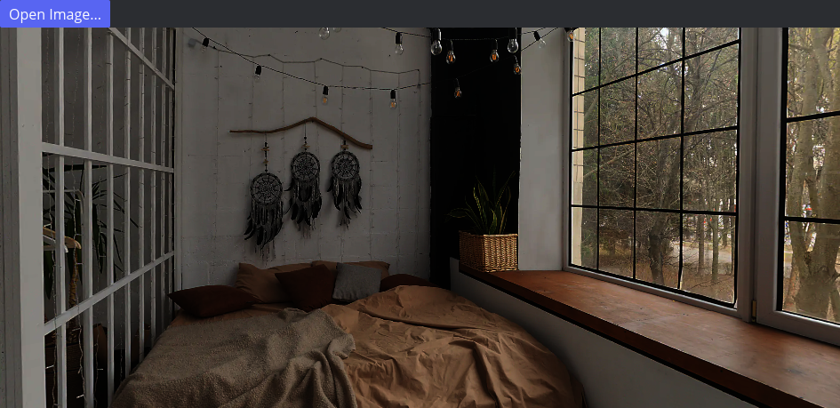

# 🌐 Photosphere Viewer

A 360° photo viewer for Linux, written in Rust on top of [iced]. Drag around
to look, built-in file picker, no CLI arguments required.



## Why this exists

My real estate broker took 360° photos of a house and then just... wouldn't
hand them over. Fine — but the Linux photosphere viewers I could find were
either abandoned or only handled a single image with no gallery. So: a
weekend project. It somewhat got out of hand.

## Features

- **Drag to look around**, updating live while you drag, not just on release
- **Two render backends**, built side by side as a kind of running
  experiment:
  - `photosphere_viewer` — pure CPU, software reprojection, parallelized
    across cores with [rayon]
  - `gpu_viewer` — an actual textured sphere mesh rendered on the GPU via
    [wgpu], the same technique real browser-based photosphere viewers use
- **A reusable widget.** The GPU renderer is packaged as its own crate,
  [`iced_photosphere`](iced_photosphere), so any iced 0.14 app can embed a
  photosphere viewer in a couple of lines
- **No CLI argument needed** — launches straight into a file picker, or pass
  a path to open it directly
- Resize-aware: the CPU renderer matches its render resolution to the window
  and downscales its source image after you stop resizing, so dragging a
  large window around doesn't tank your frame rate

## Quick start

```sh
git clone <this-repo>
cd photosphere_viewer
cargo run --release --bin gpu_viewer
```

Click "Open Image...", pick an equirectangular (`.jpg`/`.jpeg`/`.png`) photo,
and drag to look around. You can also launch straight into a photo:

```sh
cargo run --release --bin gpu_viewer -- path/to/photo.jpg
```

The CPU renderer works the same way, as the `photosphere_viewer` binary:

```sh
cargo run --release --bin photosphere_viewer
```

> [!IMPORTANT]
> Always build with `--release`. Decoding a large JPEG in debug mode is
> brutally slow — on an 8192×4096 real photo, decode time measured at
> **24.6 seconds in debug** vs. **375ms in release**. Same story for the CPU
> renderer's reprojection math: roughly a 10x difference. None of this is
> GPU-bound work; it's plain Rust number-crunching that only the optimizer
> makes fast.

## Project layout

```
src/projection.rs        CPU equirectangular → perspective reprojection math
src/main.rs               CPU viewer binary (photosphere_viewer)
src/bin/gpu_viewer.rs      GPU viewer binary
src/bin/make_test_pattern.rs   generates a synthetic test equirectangular image
src/bin/render_view.rs    CLI benchmark harness for the CPU renderer
iced_photosphere/          standalone widget crate (the GPU viewer's guts)
```

## Using the widget in your own app

```rust
iced_photosphere::photosphere(&source) // source: &Arc<image::RgbaImage>
    .width(Length::Fill)
    .height(Length::Fill)
```

That's the entire public API: a function that returns something you can
`.into()` as an `Element`. Drag-to-look-around, the sphere mesh, the shader
pipeline — all private implementation details behind it. The crate has no
dependency on anything from this repo's binaries.

## How it works

**CPU path:** for each output pixel, cast a ray from the camera through that
pixel (using the field of view), rotate it by the current pitch and yaw, turn
the resulting 3D direction into a longitude/latitude pair, and sample the
source image at that point. Done in parallel, row by row, with the
per-render-constant trig hoisted out of the pixel loop — that one change plus
row-level (not pixel-level) `rayon` chunking is what got this to a real ~10x
speedup over the naive version.

**GPU path:** instead of doing that math per *pixel* per *frame*, build an
actual sphere mesh once, wrap the photo around the inside of it as a texture,
and let the GPU's ordinary rasterization pipeline do the rest. The "which
part of the photo is this" math only runs once per vertex, at mesh-build
time — a few thousand vertices, built once per loaded photo, not O(pixels ×
frames). This is the same approach used by essentially every real
photosphere viewer, browser-based ones included.

## A known wrinkle: the patched `iced` dependency

This repo currently points `iced` (and its sibling crates) at a locally
patched clone of [iced-rs/iced], tag `0.14.0`, via `[patch.crates-io]` in
`Cargo.toml`. The one change: `desired_maximum_frame_latency` in
`iced_wgpu`'s `compositor.rs`, bumped from `1` to `3`, which noticeably
reduced flicker while live-resizing the GPU shader widget. `iced` doesn't
expose this as a public setting (unlike present mode, which has an env var),
so a source patch is the only way to tune it today.

To build this repo, you'll need that clone sitting next to it:

```sh
git clone --branch 0.14.0 https://github.com/iced-rs/iced.git ../iced-patched
```

Then edit `../iced-patched/wgpu/src/window/compositor.rs`, changing
`desired_maximum_frame_latency: 1` to `desired_maximum_frame_latency: 3`
inside `configure_surface`.

## License

[`iced_photosphere`](iced_photosphere) is dual-licensed under MIT or
Apache-2.0. The rest of the repo doesn't carry a license file yet.

[iced]: https://github.com/iced-rs/iced
[iced-rs/iced]: https://github.com/iced-rs/iced
[rayon]: https://github.com/rayon-rs/rayon
[wgpu]: https://github.com/gfx-rs/wgpu
